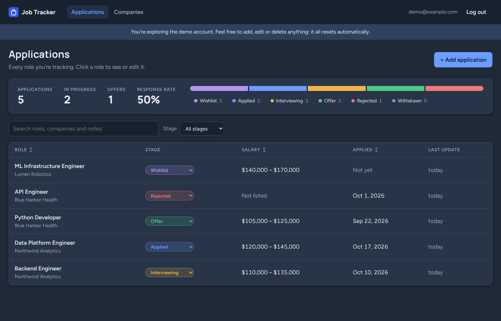
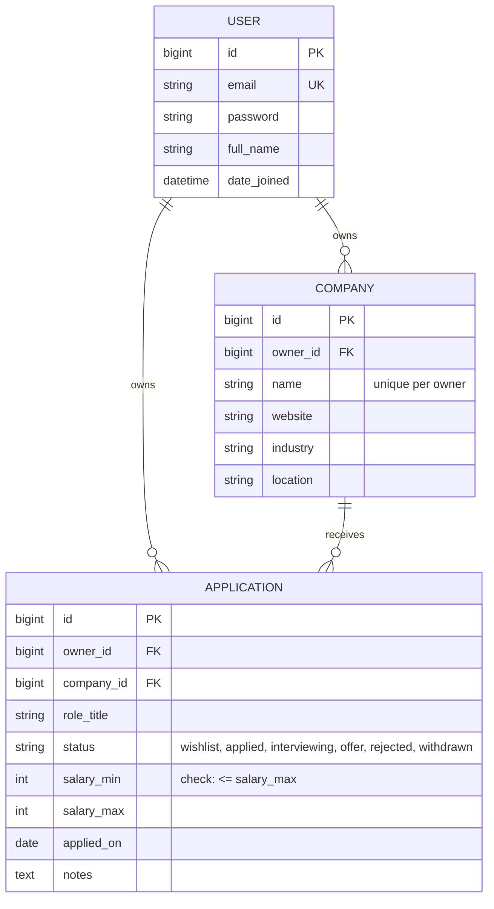

# Job Tracker


**A web app for keeping track of job applications, from "I'd like to work there" to the final offer.**

**[Try the live demo](https://YOUR-SITE.netlify.app)**: click **Explore the demo** and you're in, no sign-up needed.

> The demo runs on free hosting that goes to sleep when nobody is using it. If the page says it's waking up the
> server, give it up to a minute and it will load.



## What it does

Looking for a job means juggling dozens of applications at different stages. Job Tracker keeps them in one place:

- **See every application at a glance** in one table, with a colour-coded bar showing how many sit at each stage:
  wishlist, applied, interviewing, offer, rejected or withdrawn.
- **Sort and filter** by salary, date applied or stage, and move an application to its next stage in one click.
- **Save the details that matter**: the company, salary range, date applied, a link to the job posting and your own notes.
- **Track how your search is going**: total applications, interviews, offers, and your response rate (how often
  companies get back to you).
- **Search** across job titles, companies and notes.
- **Your data is private.** Each person has their own account and can only ever see their own applications.

## How it's built

The project has three parts that work together:

| Part | What it does | Built with |
|---|---|---|
| **Website** (frontend) | The pages you see and click on | React, JavaScript, CSS |
| **API** (backend) | Handles logins, saves and checks data, and answers the website's requests | Python, Django, Django REST Framework |
| **Database** | Stores accounts, companies and applications | PostgreSQL |

When you click something on the website, it sends a request to the API. The API checks who you are, reads or
updates the database, and sends the result back for the website to display.

All three run on free hosting: the website on **Netlify**, the API on **Render**, and the database on **Neon**.

## Highlights

- **Full stack**: a React frontend talking to a REST API I designed, backed by a relational database.
- **Secure logins** with JSON Web Tokens. The website quietly renews your login in the background so you stay
  signed in.
- **Data rules enforced twice**: the API gives clear error messages (like "The minimum salary can't be higher than
  the maximum"), and the database itself refuses bad data as a second line of defence.
- **A shared demo account** that resets itself automatically, so every visitor gets a clean demo.
- **44 automated tests** (32 for the API, 12 for the website) that run on every change with GitHub Actions.
- **Interactive API documentation** generated automatically with Swagger.
- **Works on phones**, and supports dark mode.

---

## For developers

Everything below is technical detail about how the project works and how to run it.

### Tech stack

- **Backend:** Python 3.12, Django 6.1, Django REST Framework 3.18, `djangorestframework-simplejwt`, `django-filter`,
  `drf-spectacular`, PostgreSQL 16
- **Frontend:** React 19, React Router 7, Vite 8, Vitest and Testing Library
- **Tooling:** GitHub Actions, Ruff, Docker, Gunicorn, WhiteNoise

### Project structure

```
config/                Django settings, root URLs, WSGI
accounts/              Custom email-based User model, registration, JWT and profile endpoints, demo account rules
tracker/
  models.py            Company and Application, with database constraints
  serializers.py       Validation and nested company summaries
  views.py             ViewSets, ownership mixin, stats action
  filters.py           FilterSet and nulls-last ordering
  management/commands/seed_demo.py   Loads (or resets) the demo account
  tests.py             API tests
frontend/
  src/api/             fetch wrapper with token refresh, one function per endpoint
  src/pages/           Login, sign-up, applications table, application form, companies
  src/api/mock.js      In-browser copy of the API used by the standalone demo build
  src/components/      Layout, form fields, stage summary, "waking up the server" notice
docs/                  Screenshots
```

### Data model



### API endpoints

Full interactive docs are at `/api/docs/` on the API.

| Method | Path | Description |
|---|---|---|
| `POST` | `/api/auth/register/` | Create an account |
| `POST` | `/api/auth/token/` | Get access and refresh tokens (`email`, `password`) |
| `POST` | `/api/auth/token/refresh/` | Get a new access token |
| `GET` / `PATCH` | `/api/auth/me/` | View or update your profile (includes `is_demo`) |
| `GET` / `POST` | `/api/companies/` | List (`search`, `industry`, `ordering`) or create companies |
| `GET` / `PUT` / `PATCH` / `DELETE` | `/api/companies/{id}/` | Company detail |
| `GET` / `POST` | `/api/applications/` | List or create applications |
| `GET` | `/api/applications/stats/` | Counts by status and response rate |
| `GET` / `PUT` / `PATCH` / `DELETE` | `/api/applications/{id}/` | Application detail |
| `GET` | `/health/` | Liveness and database check |

Application list parameters: `status`, `company`, `applied_after`, `applied_before`, `min_salary`, `search`
(role, notes and company name), `ordering` (`created_at`, `applied_on`, `role_title`, `salary_max`, prefix `-` for
descending), `limit`, `offset`.

### Running locally

You'll need Python 3.12+ and Node.js 20.19+ (or 22.12+).

**1. Start the API** (uses SQLite unless you set `DATABASE_URL`):

```bash
python -m venv .venv && source .venv/bin/activate   # Windows: .venv\Scripts\activate
pip install -r requirements-dev.txt
python manage.py migrate
python manage.py seed_demo          # demo account: demo@example.com / Demo-password-2026
python manage.py runserver          # http://localhost:8000
```

Or with Docker, which also starts Postgres: `docker compose up --build`.

**2. Start the website** in a second terminal:

```bash
cd frontend
npm install
npm run dev                         # http://localhost:5173
```

The website looks for the API at `http://localhost:8000` by default. To point it elsewhere, copy
`frontend/.env.example` to `frontend/.env` and change `VITE_API_URL`.

### Tests and code quality

```bash
python manage.py test               # API tests (SQLite by default; set DATABASE_URL to test on Postgres)
ruff check . && ruff format --check .
cd frontend && npm test             # website tests
```

CI (`.github/workflows/ci.yml`) runs the API tests against Postgres 16, linting, `manage.py check --deploy`,
a migration drift check and OpenAPI schema validation, then tests and builds the frontend.

### Deploying

See [DEPLOY.md](DEPLOY.md) for a step-by-step guide to hosting the whole project for free.

### Design decisions

- **Ownership in one mixin.** `OwnedQuerysetMixin` filters every query by the current user and sets the owner on
  create, so no view can leak or misassign data. Other users' records return 404, not 403, so IDs can't be probed.
- **Company choices scoped per request.** The application serializer limits `company_id` to the user's own
  companies, so attaching an application to someone else's company is a validation error.
- **Validation in the API and the database.** Serializers give readable errors; `UniqueConstraint` and
  `CheckConstraint` guarantee the rules even for data written through the admin or a shell.
- **A self-healing demo.** The container runs `seed_demo --reset` on startup. Render's free tier restarts the
  server after it sleeps, so the demo data is restored regularly. The demo profile is read-only.
- **Token refresh in one place.** The frontend's `request()` helper retries once with a fresh access token after a
  401, and concurrent requests share a single refresh call.
- **Sorting and filtering in the API.** The table's column headers and stage filters map straight to the API's
  `ordering` and `status` parameters, so the database does the work.
- **`select_related` and annotated counts** keep list endpoints to a single query each.

### Possible next steps

- Interview events with dates and reminder emails
- Token blacklisting on logout
- Charts of applications over time

## License

MIT, see [LICENSE](LICENSE).
